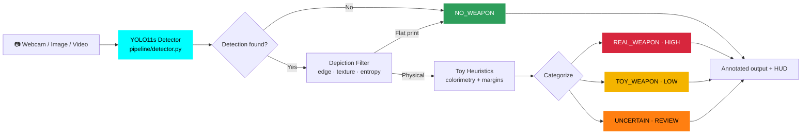

<div align="center">


<br/>


**Detect it. Classify it. Rate the threat.**
Live webcam analysis, image scanning and full surveillance-video processing in one dashboard.

[Features](#-key-capabilities) · [Model](#-model--training) · [Quick Start](#-quick-start) · [API](#-api-reference) · [Tests](#-testing) · [Architecture](#-project-architecture)

</div>

---

## 📌 Key Capabilities

| | Capability | What it does |
|:-:|---|---|
| ⚡ | **Real-time detection** | Handguns, pistols, revolvers, knives, machetes and other bladed threats, with sub-30 ms latency on GPU and ~80 ms on CPU |
| 🖼️ | **Physical vs. printed depiction** | Filters flat 2D weapon art on t-shirts, posters and stickers using edge, texture and entropy analysis, without suppressing real weapons |
| 🧸 | **Toy vs. real classification** | Separates real firearms and knives from toy replicas, nerf blasters and water guns using colorimetry (safety blaze-orange tips) and trained feature margins |
| 🎥 | **Video upload and analysis** | Ingests `.mp4` `.avi` `.mov` `.mkv` `.webm`, overlays boxes and HUD diagnostics, exports an annotated video with jump-to-timestamp navigation |
| 📷 | **Live Camera Studio** | Real-time snapshot capture with multi-threat confidence meters |
| 🖥️ | **Cyberpunk dashboard** | Responsive neon UI served directly by the FastAPI backend |

### 🚨 Threat Categories

| Category | Meaning | Alert level |
|---|---|:-:|
| `REAL_WEAPON` | Confirmed physical firearm or knife | 🔴 **HIGH** |
| `TOY_WEAPON` | Toy gun or replica | 🟡 **LOW** |
| `UNCERTAIN` | Borderline confidence or ambiguous silhouette, needs human verification | 🟠 **REVIEW** |
| `NO_WEAPON` | Weapon-free frame, or flat printed depiction filtered out | 🟢 **NONE** |

---

## 🧠 How It Works



---

## 🔬 Model & Training

The system uses a **two-phase trained YOLO11s** checkpoint (Ultralytics, 9.42M parameters, 21.4 GFLOPs).

| | Phase 1: Baseline | Phase 2: Toy fine-tune |
|---|---|---|
| **Run** | `weapon_yolo11s-2` | `weapon_yolo11s_toy_finetune` |
| **Start weights** | Pretrained YOLO11s | `weapon_yolo11s-2/weights/best.pt` |
| **Data** | 3,385 train · 725 val · 727 test (Sohas knives + Armas firearms + background negatives) | Adds Roboflow toy-firearm data: toy samples 217 → 907, 4,072 training images total |
| **Schedule** | 100 epochs, AdamW, cosine LR, mosaic augmentation | 25 epochs, `lr0 = 0.0002` |
| **Result** | Peak mAP@50 **88.1%**, mAP@50-95 **61.2%** (epoch 79) | mAP@50 **90.84%**, mAP@50-95 **67.31%** |

### 📊 Test-Split Benchmark (727 unseen images)

| Metric | Score |
|---|:-:|
| Overall Precision | **92.7%** |
| Overall Recall | **89.3%** |
| Overall F1-Score | **90.9%** |
| Real Weapon mAP@50 | **85.1%** |
| Toy Weapon mAP@50 | **91.8%** |

> ✅ **Checkpoint provenance:** the root `best.pt` was verified through safe dictionary metadata inspection to be identical to `training/weapon_yolo11s_toy_finetune/weights/best.pt` (Phase 2, epoch 25), so all **125 training epochs** are included. A pristine backup is kept as `best.pt.backup`.

---

## 🚀 Quick Start

### Prerequisites

- Windows 10/11 or Linux
- Python 3.10+ (Anaconda or standard Python)
- *Optional:* NVIDIA GPU with CUDA for real-time video batch acceleration

### Install

```bash
# enter the project folder
cd weapon_detection_project

# install dependencies
pip install -r requirements.txt
```

### Run

<table>
<tr>
<td width="33%" valign="top">

**⚡ Option A: One-click**

```cmd
run_project.bat
```

Sets the OpenMP workarounds, starts the FastAPI backend and opens `http://127.0.0.1:8000` in your browser.

</td>
<td width="33%" valign="top">

**🧩 Option B: Manual backend**

```bash
python backend.py
```

Then open
[http://127.0.0.1:8000](http://127.0.0.1:8000)

</td>
<td width="33%" valign="top">

**📊 Option C: Streamlit**

```cmd
run_app.bat
```

Launches the alternative dashboard at `http://localhost:8501`.

</td>
</tr>
</table>

---

## 📡 API Reference

| Method | Endpoint | Purpose |
|:-:|---|---|
| `GET` | `/health` | Backend status, loaded weights, active categories |
| `POST` | `/detect` | Analyze a base64 image |
| `POST` | `/detect/file` | Analyze an uploaded image file (`.jpg` `.png` `.webp`) |
| `POST` | `/detect/video` | Queue a video for analysis |
| `GET` | `/video/status/{job_id}` | Poll progress and results |
| `GET` | `/download/video/{job_id}` | Download the annotated `.mp4` |
| `GET` | `/stream/video/{job_id}` | In-browser playback of the processed video |

<details>
<summary><b>🖼️ POST /detect: request and response</b></summary>

**Body**

```json
{"image": "data:image/jpeg;base64,...", "conf_threshold": 0.20}
```

**Response**

```json
{
  "status": "success",
  "detections": [
    {
      "class": "Real Weapon (Gun/Knife)",
      "category": "REAL_WEAPON",
      "threat_level": "HIGH",
      "confidence": 91.4,
      "bbox": {"x": 0.24, "y": 0.18, "w": 0.35, "h": 0.42}
    }
  ],
  "count": 1,
  "processing_time_ms": 28.4,
  "image_size": [640, 480]
}
```

</details>

<details>
<summary><b>🎞️ Video pipeline: POST /detect/video and polling</b></summary>

**Form data**

| Field | Type | Default | Notes |
|---|---|---|---|
| `file` | binary | n/a | `.mp4` `.avi` `.mov` `.mkv` `.webm`, max 100 MB |
| `conf_threshold` | float | `0.20` | Minimum detection confidence |
| `frame_stride` | int | `2` | `2` means analyze every 2nd frame |

**Response**

```json
{"job_id": "...", "status": "queued", "status_url": "/video/status/{job_id}"}
```

`GET /video/status/{job_id}` returns `progress_percent`, `current_frame`, `total_frames` and detection summaries on completion.

</details>

---

## 🧪 Testing

```bash
pytest tests -v
```

| # | Test | Verifies |
|:-:|---|---|
| 1 | `test_health_endpoint` | API health and metadata |
| 2 | `test_detect_image_base64` | Base64 inference and response schema |
| 3 | `test_detect_image_invalid_base64` | Graceful handling of corrupted payloads |
| 4 | `test_detect_image_file_multipart` | Multipart file uploads |
| 5 | `test_video_analysis_workflow` | End-to-end upload, frame processing, polling, H.264 generation |
| 6 | `test_video_upload_validation_errors` | Rejects bad extensions, oversized or empty files, path traversal |
| 7 | `test_model_loading` | Checkpoint verification and class mapping |
| 8 | `test_physical_vs_depiction_analysis` | Edge, texture and entropy analysis for shirt prints |
| 9 | `test_toy_color_heuristics` | Blaze-orange safety-tip colorimetry |
| 10 | `test_categorize_detection` | Tiered categorization into the four threat classes |
| 11 | `test_predict_image_execution` | Full inference pipeline |

---

## 📁 Project Architecture

```text
weapon_detection_project/
├── backend.py                   FastAPI REST API and static server
├── best.pt                      YOLO11s trained weights (125 epochs)
├── best.pt.backup               Original backup of weights
├── requirements.txt             Project dependencies
├── run_project.bat              One-click Windows launcher
├── run_backend.bat              Backend launcher
├── run_app.bat                  Streamlit launcher
├── app.py                       Alternative Streamlit dashboard
├── pipeline/                    Modular AI pipeline
│   ├── classifier.py            Depiction and toy weapon classifier
│   ├── detector.py              YOLO11s inference and annotation
│   └── video_processor.py       Frame processing and MP4 encoder
├── frontend/                    Web UI
│   ├── index.html               Main dashboard with video upload
│   ├── styles.css               Cyberpunk neon responsive styles
│   └── script.js                Async client and video polling
├── tests/                       Automated test suite
│   ├── test_backend.py          API and video endpoint tests
│   └── test_pipeline.py         Model and classification unit tests
└── training/                    Training logs and validation curves
    ├── weapon_yolo11s-2/            Phase 1 (100 epochs baseline)
    └── weapon_yolo11s_toy_finetune/ Phase 2 (25 epochs fine-tune)
```

---

## 🛡️ Security & Reliability

| | Feature | Details |
|:-:|---|---|
| 🔒 | **Path traversal protection** | Job IDs are validated with a UUID regex; download paths are restricted to the temporary outputs directory |
| 🧹 | **Safe file deletion** | Temporary uploads and outputs older than 1 hour are purged automatically |
| 📏 | **Resource limits** | Maximum upload size 100 MB, maximum video duration 180 s |
| ⏱️ | **Async processing** | Long video jobs run as background tasks, so there are no HTTP timeouts and the UI stays responsive |

---

## ⚠️ Disclaimer

This system is a decision-support tool. `UNCERTAIN` and `HIGH` alerts should always be verified by a trained human operator before any action is taken. Accuracy depends on lighting, camera angle and image quality.

---

## 🗓️ Roadmap

- [x] YOLO11s baseline (100 epochs)
- [x] Toy-weapon fine-tuning (25 epochs)
- [x] Depiction filter and toy heuristics
- [x] Video upload with annotated export
- [x] Automated pytest suite
- [ ] Multi-camera / RTSP stream support
- [ ] Alert notifications (email / webhook)
- [ ] Docker image for one-command deployment

---

## 👨‍💻 Author

<div align="center">

**Muhammad Furqan**
Computer Science Student · The Superior University, Lahore

[](https://github.com/furqanzubair209-cell)
[](https://www.linkedin.com/in/muhammad-furqan-228807304)
[](https://furqannewportfolio.netlify.app)

⭐ If this project helped you, consider starring the repository.


</div>
