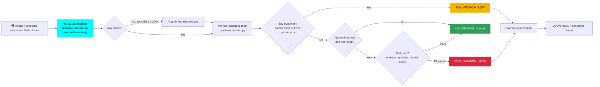

<div align="center">


<br/>


**Detect it. Classify it. Rate the threat.**
Image scanning, webcam snapshots and full video analysis in one dashboard, served by a single FastAPI backend.

[Demo](#-demo) · [Features](#-key-capabilities) · [How it works](#-how-it-works) · [Model](#-model--training) · [Quick start](#-quick-start) · [API](#-api-reference) · [Tests](#-testing) · [Limitations](#-honest-limitations)

</div>

---

## 📸 Demo

<table>
<tr>
<td width="33%" align="center"><br/><sub><b>Image upload</b> · firearm detection</sub></td>
<td width="33%" align="center"><br/><sub><b>Image upload</b> · knife detection</sub></td>
<td width="33%" align="center"><br/><sub><b>Webcam snapshot</b> · live threat meters</sub></td>
</tr>
</table>

---

## 📌 Key Capabilities

| | Capability | What it does |
|:-:|---|---|
| 🎯 | **Weapon detection** | YOLO11s detects firearms and knives and assigns each one a threat category. Large images are run at higher resolution (640 / 800 / 960 px) so thin blades and small objects survive |
| 🔁 | **Rescue pass** | If the first pass finds nothing at sensitivity ≤ 20%, a second test-time-augmented pass runs to recover thin blades, distant firearms and awkward lighting |
| 🖼️ | **Physical vs. printed depiction** | Flags flat 2D weapon art (shirt prints, posters) using entropy, gradient and texture analysis, with a guard so metallic, high-texture objects are never dismissed as prints |
| 🧸 | **Toy vs. real classification** | Combines the model's `toy_weapon` class with HSV colorimetry (blaze-orange safety tips, neon plastics) and a metal-surface check that protects real weapons from being relabeled |
| 🎥 | **Video analysis** | Upload `.mp4` `.avi` `.mov` `.mkv` `.webm`, get an annotated video back, a threat summary, and a clickable timeline that jumps the player to each detection |
| 📷 | **Webcam snapshots** | Capture a frame from your camera, analyze it, and see per-class confidence meters plus a running detection log |
| 🖥️ | **Neon dashboard** | Responsive single-page UI (no build step) served directly by the backend |

### 🚨 Threat Categories

| Category | Meaning | Threat level | Box color |
|---|---|:-:|:-:|
| `REAL_WEAPON` | Physical firearm or knife | 🔴 **HIGH** | Red |
| `TOY_WEAPON` | Toy gun, replica or imitation | 🟡 **LOW** | Amber |
| `NO_WEAPON` | Below threshold, background noise, or flat printed depiction | 🟢 **NONE** | Suppressed from output |

> `NO_WEAPON` results are filtered out of API responses by default, so a clean frame simply returns an empty `detections` list.

---

## 🧠 How It Works



**Confidence reporting.** The `confidence` field is a *calibrated operational score*, not the raw network output. Confirmed physical detections are mapped to a 75-99% range so a verified weapon never shows a confusing 15% label. The untouched model score is always returned alongside it as `raw_confidence`; use that one for threshold tuning or evaluation.

---

## 🔬 Model & Training

A **two-phase trained YOLO11s** model (Ultralytics, 9.41M parameters, 21.4 GFLOPs, classes `real_weapon` and `toy_weapon`). The full pipeline, from dataset conversion to evaluation and ONNX export, is documented in [`Weapon_Detection_System.ipynb`](Weapon_Detection_System.ipynb).

| | Phase 1: Baseline | Phase 2: Toy fine-tune |
|---|---|---|
| **Start weights** | Pretrained YOLO11s | Phase 1 `best.pt` |
| **Data** | Sohas (knives) + Armas (firearms) + background negatives, converted to YOLO format | Adds 687 toy-weapon images (690 boxes): toy boxes 217 → 907 |
| **Split** | 70 / 15 / 15 → 3,385 train · 725 val · 727 test | 4,072 train · 725 val · 727 test |
| **Schedule** | Up to 100 epochs, AdamW, mosaic/mixup augmentation, early stopping | 25 epochs, `lr0 = 0.0002`, AdamW |
| **Peak result** | Epoch 79: mAP@50 **88.1%**, mAP@50-95 **61.2%** (validation) | mAP@50 **90.8%**, mAP@50-95 **67.3%** (validation) |

### 🗂️ Dataset Breakdown

| | Images | Real-weapon boxes | Toy-weapon boxes | Notes |
|---|:-:|:-:|:-:|---|
| **Phase 1 dataset (merged)** | 4,837 | 3,800 | 300 | Includes 757 background / no-object images (hard negatives) |
| **Phase 2 · Train** | 4,072 | 2,647 | 907 | After adding 687 toy images |
| **Phase 2 · Validation** | 725 | 594 | 31 | Used for checkpoint selection |
| **Phase 2 · Test** | 727 | 559 | 52 | Never seen during training; used for the benchmark below |

### 📊 Held-out Test Benchmark (727 unseen images, Phase 2 model)

| Class | Instances | Precision | Recall | F1 | mAP@50 | mAP@50-95 |
|---|:-:|:-:|:-:|:-:|:-:|:-:|
| `real_weapon` | 559 | 93.1% | 86.2% | 89.5% | **85.1%** | 65.1% |
| `toy_weapon` | 52 | 92.3% | 92.3% | 92.3% | **91.8%** | 64.0% |
| **All** | 611 | **92.7%** | **89.3%** | **90.9%** | **88.4%** | **64.5%** |

> 📝 The 90.8% / 67.3% figures in the Phase 2 row are from the **validation** split used during training. The table above is the honest, unseen **test** result, and it is the one to quote.

### ⚡ Speed

| Setup | Measured | Source |
|---|---|---|
| Tesla T4 GPU, 640 px, model inference only | **~10 ms / image** | Phase 2 validation run in the notebook |
| Colab Xeon CPU, batched test evaluation | ~530 ms / image | Test evaluation in the notebook |
| Full pipeline on a CPU laptop, one webcam snapshot | ~600 ms | Dashboard screenshot above |

End-to-end latency includes preprocessing, optional rescue pass, color/texture analysis and JSON encoding, so expect it to be higher than raw model inference. A CUDA GPU makes the biggest difference.

---

## 🚀 Quick Start

### Prerequisites

- Python 3.10+
- Optional: NVIDIA GPU with CUDA for much faster video processing

### Install

```bash
git clone https://github.com/furqanzubair209-cell/ai-weapon-threat-detection.git
cd ai-weapon-threat-detection

python -m venv .venv
# Windows: .venv\Scripts\activate    ·    Linux/macOS: source .venv/bin/activate

pip install -r requirements.txt
```

The trained weights ship in the repo as `best.pt` (about 19 MB), so no extra download is needed.

### Run

<table>
<tr>
<td width="50%" valign="top">

**⚡ Option A: One-click (Windows)**

```cmd
run_project.bat
```

Sets the OpenMP workaround, starts the backend and opens `http://127.0.0.1:8000`. It looks for Anaconda at a fixed path first and falls back to `python` on your `PATH`.

</td>
<td width="50%" valign="top">

**🧩 Option B: Any OS**

```bash
python backend.py
```

Then open
[http://127.0.0.1:8000](http://127.0.0.1:8000)

Interactive API docs: [`/docs`](http://127.0.0.1:8000/docs)

</td>
</tr>
</table>

> `run_backend.bat` is an equivalent Windows launcher.

---

## 📡 API Reference

| Method | Endpoint | Purpose |
|:-:|---|---|
| `GET` | `/health` | Backend status, loaded weights, model classes, categories |
| `POST` | `/detect` | Analyze a base64 image |
| `POST` | `/detect/file` | Analyze an uploaded image file (multipart) |
| `POST` | `/detect/video` | Queue a video for background analysis |
| `GET` | `/video/status/{job_id}` | Poll progress and results |
| `GET` | `/download/video/{job_id}` | Download the annotated `.mp4` |
| `GET` | `/stream/video/{job_id}` | In-browser playback of the processed video |

<details>
<summary><b>🖼️ POST /detect: request and response</b></summary>

**Body** (`conf_threshold` defaults to `0.15`)

```json
{"image": "data:image/jpeg;base64,...", "conf_threshold": 0.15}
```

**Response**

```json
{
  "status": "success",
  "detections": [
    {
      "class": "Real Weapon (Knife/Gun)",
      "category": "REAL_WEAPON",
      "threat_level": "HIGH",
      "confidence": 91.2,
      "raw_confidence": 66.4,
      "raw_class_id": 0,
      "type": "real",
      "verdict_reason": "Physical weapon verified",
      "bbox": {"x": 0.24, "y": 0.18, "w": 0.35, "h": 0.42},
      "bbox_px": [154, 86, 378, 288]
    }
  ],
  "count": 1,
  "processing_time_ms": 615.6,
  "image_size": [640, 480]
}
```

`bbox` is normalized (0-1, top-left origin). `bbox_px` is in pixels. `confidence` is calibrated; `raw_confidence` is the model's own score.

</details>

<details>
<summary><b>🎞️ Video pipeline: POST /detect/video and polling</b></summary>

**Form data**

| Field | Type | Default | Notes |
|---|---|---|---|
| `file` | binary | n/a | `.mp4` `.avi` `.mov` `.mkv` `.webm`, max 100 MB |
| `conf_threshold` | float | `0.15` | Minimum detection sensitivity |
| `frame_stride` | int | `2` | `2` means run inference on every 2nd frame and reuse boxes in between |

**Response**

```json
{"job_id": "…", "status": "queued", "message": "Video analysis queued successfully.", "status_url": "/video/status/{job_id}"}
```

`GET /video/status/{job_id}` returns `status` (`queued` → `processing` → `completed` or `failed`), `progress_percent`, `current_frame`, `total_frames`, `fps` and `duration_sec`. On completion it adds a `summary` with `total_detections`, `highest_threat` and a `timeline` of the first 50 detection events (timestamp, class, category, confidence, box).

</details>

<details>
<summary><b>🧪 Quick test with curl</b></summary>

```bash
# health
curl http://127.0.0.1:8000/health

# image file
curl -F "file=@sample.jpg" -F "conf_threshold=0.15" http://127.0.0.1:8000/detect/file

# video, then poll
curl -F "file=@clip.mp4" http://127.0.0.1:8000/detect/video
curl http://127.0.0.1:8000/video/status/<job_id>
```

</details>

---

## 🧪 Testing

```bash
pytest tests -v
```

| # | Test | Verifies |
|:-:|---|---|
| 1 | `test_health_endpoint` | API health and metadata |
| 2 | `test_detect_image_base64` | Base64 inference and response schema |
| 3 | `test_detect_image_invalid_base64` | Graceful handling of corrupted payloads |
| 4 | `test_detect_image_file_multipart` | Multipart file uploads |
| 5 | `test_video_analysis_workflow` | End-to-end upload, processing, polling and annotated-video download |
| 6 | `test_video_upload_validation_errors` | Rejects bad extensions, empty files and malformed job IDs |
| 7 | `test_model_loading` | Checkpoint loads with the expected class mapping |
| 8 | `test_physical_vs_depiction_analysis` | Printed-depiction analysis |
| 9 | `test_toy_color_heuristics` | Blaze-orange safety-tip colorimetry |
| 10 | `test_categorize_detection` | Tiered categorization logic |
| 11 | `test_predict_image_execution` | Full inference pipeline |

---

## 📁 Project Architecture

```text
ai-weapon-threat-detection/
├── backend.py                       FastAPI REST API and static file server
├── best.pt                          Trained YOLO11s weights
├── Weapon_Detection_System.ipynb    Full training and evaluation notebook (Colab)
├── requirements.txt                 Dependencies
├── run_project.bat                  One-click Windows launcher (opens the browser)
├── run_backend.bat                  Windows backend launcher
├── images/                          README screenshots
├── pipeline/                        Modular AI pipeline
│   ├── detector.py                  YOLO11s inference, rescue pass, box cleanup, annotation
│   ├── classifier.py                Toy, depiction and threat categorization + confidence calibration
│   └── video_processor.py           Frame loop, annotated MP4 writer, job tracking, temp cleanup
├── frontend/                        Web dashboard (plain HTML, CSS, JS)
│   ├── index.html                   Image, webcam and video sections
│   ├── styles.css                   Neon responsive styling
│   └── script.js                    API client, webcam capture, video polling and timeline
└── tests/
    ├── test_backend.py              API and video endpoint tests
    └── test_pipeline.py             Model and classification unit tests
```

---

## 🛡️ Security & Reliability

| | Feature | Details |
|:-:|---|---|
| 🔒 | **Path traversal protection** | Job IDs must match a UUID-style pattern, and download paths are checked to stay inside the outputs directory |
| 🧹 | **Temp file cleanup** | Uploads and outputs older than one hour are removed (triggered on `/health`) |
| 📏 | **Resource limits** | 100 MB upload cap (streamed in 1 MB chunks) and 180 s maximum video duration |
| ⏱️ | **Background jobs** | Long videos run as background tasks, so requests return immediately and the UI polls for progress |

> This is a local demo server: CORS is open (`*`), there is no authentication, and job state is held in memory. Add auth, restrict origins and use a persistent job store before exposing it beyond your machine.

---

## 🔎 Honest Limitations

- **Small toy test set.** Only 52 toy instances in the test split, so the 91.8% toy mAP@50 has wide error bars. Real weapons dominate the data (559 of 611 test boxes).
- **Hand-tuned heuristics.** The toy and printed-depiction checks use fixed HSV, entropy and texture thresholds. They help on typical cases but will misfire on unusual lighting, painted real guns or realistic metallic toys.
- **Calibrated scores.** Displayed confidence is rescaled for readability. Use `raw_confidence` when comparing against the benchmark.
- **Webcam is snapshot-based.** The dashboard captures a frame and analyzes it; it is not a continuous live stream.
- **Dataset-bound.** Performance depends on the Sohas and Armas image styles, so expect drops on unfamiliar camera angles, low-resolution CCTV or heavily occluded objects.

---

## ⚠️ Disclaimer

This is a decision-support and research project, not a certified security product. Every `HIGH` alert should be verified by a trained human operator before any action is taken. Accuracy depends on lighting, camera angle and image quality.

---

## 🗓️ Roadmap

- [x] YOLO11s baseline training
- [x] Toy-weapon fine-tuning
- [x] Depiction filter and toy heuristics
- [x] Video upload with annotated export and clickable timeline
- [x] Automated pytest suite
- [ ] Continuous webcam / RTSP stream support
- [ ] Alert notifications (email / webhook)
- [ ] Docker image for one-command deployment
- [ ] Larger toy and hard-negative test set for tighter metrics
- [ ] Learned toy/real classifier to replace the color heuristics

---

## 👨‍💻 Author

<div align="center">

**Muhammad Furqan**
Computer Science Student · The Superior University, Lahore

[](https://github.com/furqanzubair209-cell)
[](https://www.linkedin.com/in/muhammad-furqan-228807304)
[](https://furqannewportfolio.netlify.app)

⭐ If this project helped you, consider starring the repository.


</div>
